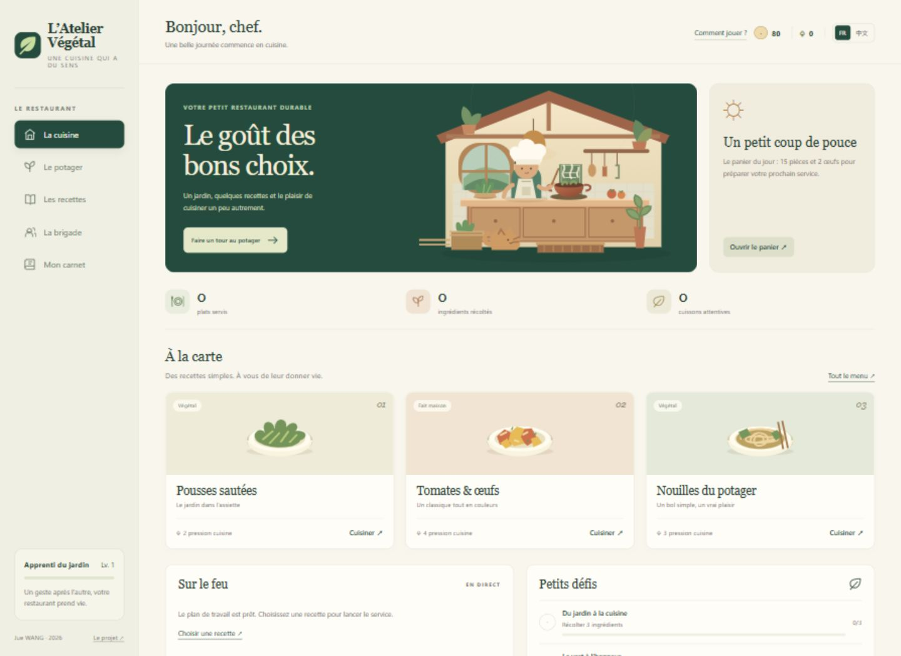

# L’Atelier Végétal

Un petit restaurant, un potager et des choix de cuisine qui font évoluer la partie. Un projet personnel de **Jue WANG**, en français et en chinois.

### [Jouer maintenant →](https://clementjue.github.io/atelier-vegetal/)

**Sans installation ni compte · Six recettes · Français / 中文**



## L’idée

Le projet explore une façon d’intégrer des gestes de cuisine durable dans une expérience ludique. Le joueur choisit ses ingrédients, affecte un chef et décide comment préparer son plat. Chaque choix produit un retour visible dans le jeu.

Le mode attentif prend une seconde de plus et réduit un score de pression illustratif. Il permet de rendre un compromis compréhensible, sans prétendre mesurer un impact environnemental réel.

## Votre premier service

1. Dans **Le potager**, récoltez les pousses déjà mûres, puis semez dans la parcelle libre.
2. Ouvrez **Les recettes** et choisissez un plat dont vous avez les ingrédients.
3. Affectez un chef disponible et sélectionnez un mode de préparation.
4. Attendez la fin de la cuisson, récupérez les récompenses et accomplissez les petits défis.

Le panier de départ permet d’essayer les premières recettes immédiatement. Le marché fournit les œufs et le porc. Les cultures poussent en 8 à 15 secondes pour permettre une courte démonstration.

| Dans le jeu | Ce que vous pouvez faire |
| --- | --- |
| Le potager | Cultiver trois parcelles et renouveler les ingrédients |
| Les recettes | Préparer six plats selon leurs ingrédients et leur niveau requis |
| La brigade | Répartir les préparations entre les chefs et recruter Bao |
| Les petits défis | Débloquer des récompenses au fil de la partie |
| Le carnet | Retrouver les recettes découvertes, les conseils et les événements |

## Le travail présenté

- **Conception produit** : parcours du premier service, règles de progression et retour sur les choix du joueur.
- **Modélisation** : stocks réservés au démarrage, compétences requises, disponibilité des chefs et récompenses uniques.
- **Réalisation** : interface responsive, illustrations SVG, traduction française et chinoise, moteur séparé de l’affichage.
- **Validation** : scénarios de jeu, tests des cas limites et vérification de la reprise d’une partie.

Les choix et leurs compromis sont détaillés dans [les décisions produit](docs/PRODUCT.md).

## Origine et évolution

J’ai écrit l’essentiel du code d’une première version personnelle. Les archives de conception conservées datent de **février 2023**. Cette édition est une **nouvelle implémentation réalisée en 2026**, qui reprend les idées documentées et les développe en un jeu autonome.

L’ancien code n’étant plus disponible, il n’est pas présenté comme le code historique retrouvé. Les illustrations de cette édition ont été créées pour le projet. Les captures du jeu de cuisine utilisé comme référence dans les archives ne sont pas distribuées.

[Consulter la provenance et le périmètre](docs/PROVENANCE.md).

## Lancer en local

Ouvrez `dist/index.html` dans un navigateur récent, ou utilisez Node.js 18 ou ultérieur pour une adresse locale stable :

```sh
node scripts/serve.cjs
```

Le jeu est alors disponible à l’adresse `http://127.0.0.1:8766`.

Le site n’a aucune dépendance à installer. La partie est sauvegardée dans le navigateur utilisé ; elle n’est pas synchronisée entre appareils. Le mode privé peut rendre cette sauvegarde éphémère.

## Architecture et vérification

| Fichier | Rôle |
| --- | --- |
| `dist/data.js` | Cultures, ingrédients, recettes, chefs et défis |
| `dist/engine.js` | Règles de jeu et validation de la sauvegarde |
| `dist/app.js` | Interface, traductions, événements et persistance locale |
| `dist/styles.css` | Mise en page responsive |
| `dist/assets/` | Illustrations SVG |
| `tests/engine.test.cjs` | Tests des règles et de la reprise de partie |

```sh
node scripts/check.cjs
node --test tests/engine.test.cjs
```

Les contrôles et les **15 tests** sont également exécutés dans GitHub Actions. Après leur réussite sur `main`, le dossier `dist` est publié automatiquement sur GitHub Pages. Les pull requests exécutent les contrôles sans publier.

[Consulter le bilan de validation](docs/VALIDATION.md).

## Limites du modèle

Les scores, durées, prix et récompenses sont des paramètres de jeu. Les indices ne constituent ni une analyse de cycle de vie, ni une mesure d’eau ou d’émissions, ni une évaluation nutritionnelle ou médicale. La sauvegarde locale convient à une démonstration individuelle.

---

**Jue WANG** · [Profil GitHub](https://github.com/clementjue)
